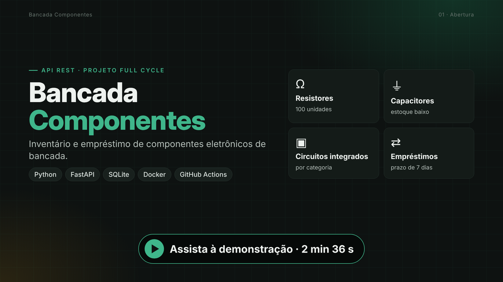

**Nível: B (simples)**

# Bancada Componentes


API para controlar o inventário e o empréstimo de componentes eletrônicos de
bancada (resistores, capacitores, circuitos integrados e similares).

## Vídeo de apresentação

[](https://www.youtube.com/watch?v=xK_5qNuyXpk)

▶️ **[Assistir no YouTube](https://www.youtube.com/watch?v=xK_5qNuyXpk)** (2 min 36 s): funcionalidades
demonstradas com chamadas reais à API, arquitetura, testes, observabilidade e
tecnologias usadas.

## Demonstração online

A API está publicada no Render (plano gratuito):

- Documentação interativa (Swagger UI): https://bancada-componentes.onrender.com/docs
- Verificação de saúde: https://bancada-componentes.onrender.com/health

> **Plano gratuito:** depois de cerca de 15 minutos sem acesso, o serviço
> "dorme", e a primeira requisição pode levar cerca de 1 minuto. O disco é
> temporário: o banco SQLite volta vazio a cada reinício ou novo deploy. É uma
> demonstração, não um ambiente de produção.

## Funcionalidades

**Fluxo principal:** cadastrar componente → emprestar → devolver → consultar o
histórico.

- Cadastro de componentes, com categoria e quantidade total.
- Consulta do estoque disponível de cada componente.
- Empréstimos com prazo de devolução calculado automaticamente.
- Devolução com reposição do estoque e cálculo dos dias de atraso.
- Histórico de empréstimos, com filtro opcional por responsável.

### Regras de negócio

| # | Regra | Resposta quando violada |
|---|---|---|
| 1 | A quantidade emprestada deve ser maior que zero. | `422` |
| 2 | Não é possível emprestar mais do que o disponível (o estoque nunca fica negativo). | `409` |
| 3 | Cada pessoa pode ter no máximo **10 unidades em aberto**, somando todos os componentes. | `409` |
| 4 | O prazo padrão de devolução é de **7 dias**. | — |
| 5 | Só é possível devolver um empréstimo com status `ABERTO`; a devolução repõe o estoque. | `409` |
| 6 | Devoluções após a data prevista registram os **dias de atraso**. | — |

As regras 3 e 4 ficam em uma política de empréstimo substituível (padrão
Strategy), justificada no
[ADR 0001](docs/adr/0001-strategy-para-politicas-de-emprestimo.md).

### Endpoints

| Método | Rota | Descrição |
|---|---|---|
| POST | `/componentes` | Cadastra um componente |
| GET | `/componentes` | Lista os componentes e o estoque disponível |
| POST | `/emprestimos` | Abre um empréstimo |
| POST | `/emprestimos/{id}/devolucao` | Registra a devolução |
| GET | `/emprestimos?responsavel=...` | Lista os empréstimos (filtro opcional por pessoa) |
| GET | `/health` | Verificação de saúde |
| GET | `/metrics` | Métricas no formato Prometheus |

Erros de negócio retornam `{"detalhe": "..."}` com o código HTTP: `404` (não
encontrado), `409` (conflito com o estado atual: estoque, limite ou devolução
repetida) e `422` (dados inválidos).

Exemplo de empréstimo:

```bash
curl -X POST http://127.0.0.1:8000/emprestimos \
  -H "Content-Type: application/json" \
  -d '{"componente_id": 1, "responsavel": "Denis", "quantidade": 5}'
```

## Tecnologias

| Área | Recursos |
|---|---|
| Linguagem e API | Python 3.14, FastAPI, Pydantic, Uvicorn |
| Dados | SQLAlchemy 2, SQLite |
| Qualidade | pytest, pytest-cov, httpx, ruff |
| Entrega | Docker, Docker Compose, GitHub Actions, Render |
| Observabilidade | Logs estruturados em JSON, prometheus-client, k6 |
| Documentação | OpenAPI 3.1, ADR, SLO |

## Como rodar

### Com Docker (recomendado)

Pré-requisito: Docker Desktop (ou Docker Engine) em execução.

```bash
docker compose up --build
```

A API fica em http://127.0.0.1:8000 e a documentação interativa em
http://127.0.0.1:8000/docs. O banco SQLite fica em um volume do Docker, então
os dados sobrevivem a `docker compose down` (para apagá-los, use
`docker compose down -v`).

### Sem Docker

```bash
python -m venv .venv
# Windows (PowerShell): .\.venv\Scripts\Activate.ps1
# Linux/macOS:          source .venv/bin/activate
pip install -r requirements-dev.txt
uvicorn app.main:app --reload
```

A variável `DATABASE_URL` é opcional (veja [`.env.example`](.env.example)); sem
ela, o banco é o arquivo `bancada.db` na pasta do projeto.

## Como testar

```bash
pytest
```

O comando roda os testes unitários do domínio e os testes de integração da API
(com banco SQLite em memória) e **falha se a cobertura ficar abaixo de 80%**.
Hoje são **31 testes**, com cerca de **98% de cobertura**.

Para o lint:

```bash
ruff check .
```

O CI (GitHub Actions) executa o lint e os testes a cada `push` na `main` e em
cada pull request.

## Observabilidade e desempenho

- **Logs estruturados:** cada requisição gera uma linha JSON com método, rota,
  status e duração em milissegundos.
- **Métrica:** histograma `http_request_duration_seconds` em `/metrics`.
- **SLO:** p95 de até 300 ms nas rotas `/componentes` e `/emprestimos`, e 99%
  ou mais das requisições sem erro 5xx (veja [`docs/slo.md`](docs/slo.md)).
- **Teste de carga com k6:** p95 medido de **145,12 ms**, com 0% de falhas em
  1.918 requisições (veja [`docs/desempenho.md`](docs/desempenho.md)).

## Arquitetura

```
app/
  domain/        regras de negócio (sem dependência de framework ou banco)
  repositories/  acesso ao banco (SQLAlchemy)
  services/      casos de uso (orquestram domínio e repositórios)
  api/           rotas e esquemas HTTP
tests/           testes unitários e de integração
docs/            documentação
k6/              script do teste de desempenho
```

## Documentação

- [`docs/openapi.yaml`](docs/openapi.yaml): especificação OpenAPI 3.1 da API
- [`docs/adr/`](docs/adr/0001-strategy-para-politicas-de-emprestimo.md): decisão de arquitetura (ADR)
- [`docs/slo.md`](docs/slo.md): objetivos de nível de serviço
- [`docs/desempenho.md`](docs/desempenho.md): teste de desempenho com k6
- [`docs/ia.md`](docs/ia.md): uso de IA no projeto

## Autoria

Projeto individual de Denis Viana ([@devdenisviana](https://github.com/devdenisviana)).
Veja [`CONTRIBUTORS.md`](CONTRIBUTORS.md).
